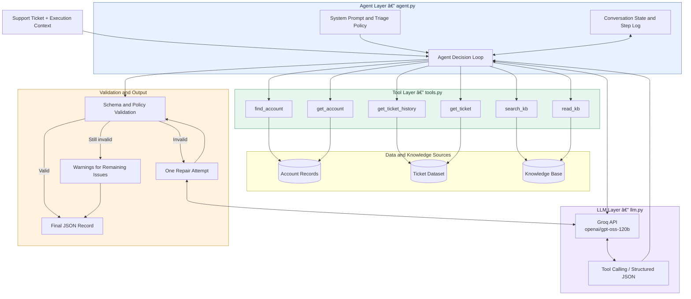
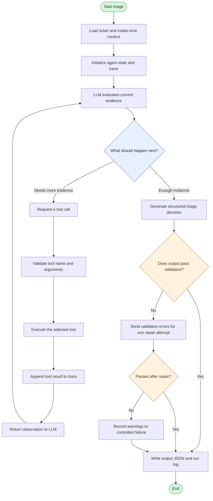

# Support Ticket Triage Agent

An agentic AI system that triages one support ticket at a time by investigating customer context, reviewing ticket history, retrieving relevant knowledge-base (KB) articles, and applying support policies before making a decision.

The system uses **`openai/gpt-oss-120b` through Groq**. Rather than following a fixed sequence of steps, the model dynamically chooses which tools to call, evaluates their results, and decides when it has enough information to produce the final triage record.

## Key Features

- **Dynamic tool calling:** The model chooses which data to retrieve and when to stop investigating.
- **Account resolution:** Handles missing or unreliable account IDs using company names and email domains.
- **Context-aware triage:** Considers account tier, health, usage trends, renewal dates, escalations, and related tickets.
- **Knowledge-base retrieval:** Searches relevant articles, reads specific sections, and follows replacement references for deprecated content.
- **Structured decisions:** Produces issue classification, priority, team routing, escalation flags, TAM notifications, duplicate status, clarification requirements, and drafted responses.
- **Validation and repair:** Checks the generated decision against the output schema, data integrity constraints, and deterministic support policies.
- **Auditable execution:** Records tool calls, observations, decisions, and validation results in a step log.
- **No hindsight leakage:** Excludes fields describing events after ticket intake from the model's context.

---

## 1. System Architecture

The system is organized into four main layers: the agent, the tool and retrieval layer, the LLM interface, and the validation/output layer.



### Component Responsibilities

| Component | Responsibility |
|---|---|
| `run.py` | Top-level CLI runner supporting `--set review`, specific ticket IDs, or `--sample N`. |
| `tam_agent/agent.py` | Runs the agent loop, supplies triage instructions, records steps, validates decisions, and implements `triage(ticket, ctx)`. |
| `tam_agent/llm.py` | Manages Groq requests, tool calls, tool results, structured output generation, rate-limit retries, and token-budget handling. |
| `tam_agent/tools.py` | Loads the datasets and exposes account, ticket-history, ticket-detail, and KB tools. |
| `tam_agent/schema.py` | Defines the required output schema, allowed decision categories/routes, and `validate(out)`. |
| `scripts/check_outputs.py` | Validates generated JSON files against the output contract (must show 10/10 valid). |
| `scripts/validate_data.py` | Verifies dataset integrity. |

The account and ticket datasets are treated as the source of truth for structured facts. The LLM interprets those facts but does not independently invent account records or ticket history.

---

## 2. Agent Workflow

The defining feature of this system is its **dynamic investigation loop**. The model chooses the next action based on what it has learned so far.



### Step-by-Step Execution

1. **Load the ticket:** The agent receives the ticket and its execution context. The ticket creation timestamp establishes the historical cutoff.
2. **Inspect available evidence:** The LLM considers the ticket text and decides what information is missing.
3. **Call tools dynamically:** It can resolve the customer, inspect account context, retrieve historical tickets, or search the KB in whatever order is appropriate.
4. **Evaluate tool results:** The model receives each result and decides whether it needs more evidence, should follow an article reference, or can stop.
5. **Produce the decision:** Once sufficient evidence is available, the model generates a structured triage record.
6. **Validate and repair:** Application code checks schema validity, referenced records, chronology, KB status, policy rules, and customer-facing content. If validation fails, one repair attempt is allowed.
7. **Persist the result:** The system writes the final JSON record and the relevant execution log. Remaining issues are surfaced through warnings or a controlled failure.

The loop has a maximum of 12 rounds as a safety limit. This prevents indefinite tool calling while allowing tickets to require different amounts of investigation.

---

## 3. Available Tools

The agent currently exposes six tools.

| Tool | Purpose |
|---|---|
| `find_account` | Finds a customer using an account ID, company name, or email domain. |
| `get_account` | Retrieves account attributes, including tier, health, usage trend, renewal information, and escalation notes. |
| `get_ticket_history` | Retrieves relevant historical tickets associated with the customer. |
| `get_ticket` | Retrieves details for an individual ticket. |
| `search_kb` | Searches the knowledge base for relevant articles or sections. |
| `read_kb` | Reads a specific KB article or section, including its status and replacement information. |

The model is not required to call all six tools for every ticket. A straightforward request may need only a customer lookup and one article, while a complex incident may require multiple account, ticket, and KB lookups.

### Knowledge-Base Retrieval

KB retrieval follows a search-then-read pattern:

1. Search for relevant articles or sections.
2. Inspect the returned titles, snippets, and metadata.
3. Read the most relevant sections.
4. Check whether an article is deprecated.
5. Follow its replacement reference when necessary.
6. Use applicable, current evidence in the final decision.

Deprecation is determined from supported metadata and document structure, including front matter, headings, banners, and superseding versions. The word "deprecated" appearing incidentally in article content is not sufficient to mark an article as deprecated.

---

## 4. Account Resolution and Data Integrity

The input data contains unreliable account identifiers, so account resolution does not blindly trust the ticket's `account_id`.

The resolution strategy is:

1. Attempt to identify the account using available identifiers.
2. Prefer a verified company-name match or a supported email-domain match when the account ID is missing or inconsistent.
3. Check whether the resolved account's company agrees with the ticket's company.
4. Record warnings for identifier mismatches.
5. Return `not_found` when no sufficiently reliable match exists.

When the account cannot be resolved, the agent uses the ticket's own `plan_tier` as a fallback where applicable.

The account record takes precedence over the ticket's `plan_tier` when a valid account has been resolved. The original account data is not silently modified.

---

## 5. Decision and Validation Pipeline

The model is responsible for interpreting the evidence and proposing the triage decision. Application code enforces data integrity and deterministic policy constraints.

The final decision covers:

- Issue category and priority.
- Assignment team and routing.
- Escalation requirements.
- TAM or account-manager notification.
- Duplicate status and related ticket references.
- Whether clarification is needed.
- Customer-facing reply.
- Internal support note.

### Validation Rules

The validation layer checks:

- Required fields and valid enum values.
- Whether cited account and ticket IDs exist.
- Whether duplicate references point to earlier tickets.
- Whether cited KB sections are current rather than deprecated.
- Whether decision flags comply with applicable deterministic rules.
- Whether the customer reply reveals internal account information.

Examples of data-based policy rules include treating feature requests as P4 and notifying the account manager when the account is At Risk or Churning, usage is Declining or Inactive, or renewal is within 90 days.

If the first result fails validation, the model receives a repair request. The repaired result is validated again. Any remaining issues are surfaced as warnings rather than being silently treated as successful validation.

### Structured Output

The final triage record is constrained by the Pydantic `Decision` schema defined in `schema.py`. The model produces the decision, while code fills authoritative customer facts and records execution steps.

The exact output fields and nesting follow the supplied schema.

---

## 6. Reasoning Trace and Auditability

Each tool interaction is recorded in execution order. The log captures the tool, its input, the model's stated reason, and the returned result.

This provides an auditable record of the agent's investigation:

- What information was requested?
- Which tools were called?
- What evidence was returned?
- Which information influenced the final decision?
- Did validation detect a problem?
- Was a repair attempt required?

The trace records observable actions and evidence rather than attempting to reconstruct a hidden chain of thought.

Customer-facing replies and internal notes are generated separately to avoid exposing internal operational or account information to the customer.

---

## 7. Model and Token-Budget Management

The current model is `openai/gpt-oss-120b` served through Groq.

The implementation accounts for rate limits and variable tool-result sizes:

- Requests that hit the configured token-per-minute limit wait and retry.
- Long tool results are shortened when necessary to fit the request budget.
- The final structured-output request is made without tool definitions because the configured Groq interface does not support tools and structured outputs together in that request mode.
- The model can be changed using `GROQ_MODEL`.

The free-tier throughput limit and actual latency depend on the model and account configuration. As a result, processing time may vary substantially across tickets.

---

## 8. Setup

### Prerequisites

- Python and a compatible virtual environment.
- A Groq API key.
- The provided ticket data and knowledge-base files.

### Install dependencies

```bash
pip install -r requirements.txt
```

Create the local environment file:

```bash
cp .env.example .env
```

Add the API key to `.env`:

```dotenv
GROQ_API_KEY=your_api_key_here
GROQ_MODEL=openai/gpt-oss-120b
```

Copy the starter repository's `data/` and `knowledge-base/` folders into the expected locations for this project.

Never commit `.env` or API keys to version control.

---

## 9. Running the Agent

Run the 10-ticket review set:

```bash
python run.py --set review
```

Process specific tickets:

```bash
python run.py TKT-10042 TKT-10050
```

Run a random sample of 10 tickets:

```bash
python run.py --sample 10
```

Validate generated outputs:

```bash
python scripts/check_outputs.py
```

**Submission note:** The hiring assignment requires processing the exact 10 tickets in `data/review_set.txt`, using the original starter repository's execution interface and checker. If this standalone implementation is being used for that submission, ensure it also supports the required review-set command and output/run-log contract before submitting.

---

## 10. Evaluation Strategy

Before production use, I would evaluate the agent on a human-reviewed dataset covering:

1. **Account resolution accuracy:** Correct identification of customers, including invalid IDs and ambiguous company names.
2. **Classification and priority accuracy:** Agreement with expert triage decisions.
3. **Routing and escalation compliance:** Correct application of support policy and account context.
4. **KB retrieval quality:** Whether relevant, current articles and policy sections are retrieved.
5. **Duplicate detection:** Precision and recall for genuinely duplicate or related tickets.
6. **Reply quality:** Factual accuracy, clarity, appropriate tone, and absence of internal data leakage.
7. **Agentic efficiency:** Tool-call relevance, unnecessary calls, missed investigations, and appropriate stopping.
8. **Operational reliability:** Schema validity, latency, token consumption, rate-limit failures, and repair success rate.

The 10-ticket review set is useful for targeted evaluation, but broader human-reviewed testing is required before relying on the system in production.

---

## 11. Scaling Considerations

The dataset contains approximately 3,000 tickets, 200 accounts, 12 months of usage metrics, and 390 KB articles.

At 10× the data volume, I would:

- Index structured account and ticket fields for efficient lookups.
- Precompute lexical KB indexes and introduce hybrid retrieval where it improves recall.
- Retrieve only the most relevant historical tickets and article sections.
- Cache reusable lookups within safe data-snapshot boundaries.
- Track per-ticket latency, token consumption, tool calls, and retrieval quality.
- Apply bounded concurrency and rate-limit-aware scheduling.
- Evaluate retrieval quality and decision accuracy against a larger benchmark.

The system does not need to load the entire ticket history or knowledge base into the prompt. Targeted tool retrieval is the main mechanism for keeping context size and cost manageable.

---

## 12. Limitations

The current implementation has several limitations:

- Ambiguous or missing company information can prevent reliable account resolution.
- KB search quality depends on the available indexing and retrieval strategy.
- Outdated or conflicting documentation can complicate decisions even with deprecation checks.
- Model output may vary across requests and provider configurations.
- The repair round cannot guarantee that every semantic error will be corrected.
- A valid schema does not guarantee a correct priority, routing decision, or customer reply.
- The 10-ticket review set is too small to establish production readiness.
- The current system generates triage recommendations; production actions such as changing ticket ownership or notifying an account manager would require appropriate integrations and authorization.

## Summary

The Support Ticket Triage Agent combines LLM-driven investigation with deterministic data access, structured output, and application-level validation.

Its central design principle is that **the model decides what evidence to gather next, while code remains responsible for data integrity, policy enforcement, and output validation**. This provides a practical foundation for explainable, context-aware support triage without loading the full dataset into the model's context or relying on a fixed sequence of LLM calls.
