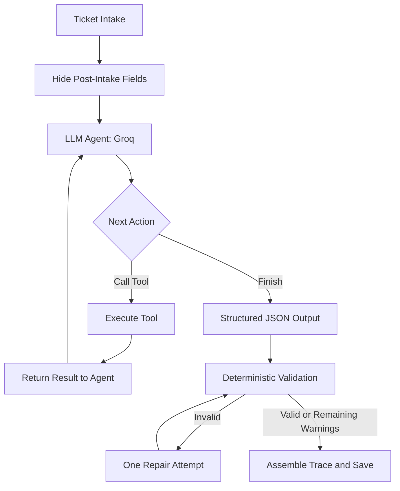

# Support Ticket Triage Agent — Solution Design

## 1. Architecture & Design Decisions

The agent uses a **single-agent, ReAct-style tool-calling loop**. Instead of following a fixed retrieval pipeline, the LLM chooses which tool to call, observes its result, decides what information is still missing, and determines when to stop investigating.



**Tools:** `find_account`, `get_account`, `get_ticket_history`, `get_ticket`, `search_kb`, and `read_kb`. They separate account resolution, structured data access, historical investigation, and knowledge-base retrieval from the model's decision-making.

**Stopping and validation:** The model stops when it has sufficient evidence or reaches a 12-round safety limit. The final decision follows the required Pydantic schema. Deterministic checks validate cited IDs, duplicate chronology, deprecated KB references, mandatory policy rules, and customer-facing data leakage. One targeted repair is attempted; unresolved issues remain visible as warnings rather than being silently treated as valid.

### Why this architecture?

| Approach | Trade-off | Decision |
|---|---|---|
| Fixed sequential pipeline | Predictable and easy to test, but performs unnecessary steps and cannot adapt investigation to evidence. | Rejected because dynamic tool selection is a core requirement. |
| Single-agent tool loop | Flexible and relatively simple, but requires loop limits, validation, and careful context management. | **Chosen** for adaptive investigation with manageable complexity. |
| LangChain | Standardizes model, tool, and retriever integrations, but adds abstractions that are not essential for six straightforward tools. | Not required for the current scope; could be adopted if integrations expand. |
| LangGraph | Provides explicit state transitions, checkpointing, resumability, and human-in-the-loop workflows, but adds setup and orchestration complexity. | Deferred until durable execution or complex branching becomes necessary. |
| Multi-agent architecture | Can separate research and decision-making, but adds coordination, latency, cost, and debugging overhead. | Rejected because one agent can handle the current workflow. |
| Vector-only KB search | Finds semantic matches but can miss exact error codes, product names, and policy wording. | Prefer hybrid retrieval at scale; retain lexical search as the current baseline. |

The key distinction is that **data volume determines retrieval and indexing needs, while workflow complexity determines orchestration needs**. The current dataset—approximately 3,000 tickets, 200 accounts, and 390 KB articles—does not justify a distributed multi-agent system or dedicated vector database by itself.

## 2. Evaluation Strategy

Evaluate against the supplied 10-ticket review set and expand to a human-labelled benchmark. Track:

- **Decision quality:** Accuracy, precision, recall, and exact match for category, priority, routing, escalation, TAM notification, and clarification.
- **Account resolution:** Correct mappings despite missing or mismatched ticket account IDs.
- **KB grounding:** Top-K retrieval quality and deprecated-article compliance.
- **Duplicate detection:** False-positive and false-negative rates against historical tickets.
- **Safety:** Customer replies must not expose ARR, churn signals, internal notes, or other confidential account data.
- **Draft quality:** Human review of empathy, helpfulness, and internal-note actionability.
- **Efficiency and reliability:** Tool calls per ticket, tokens, latency, validation failures, repair frequency, and unresolved warnings.

Run the required validator and output checker before submission. A valid JSON result alone does not establish that a triage decision is correct.

## 3. Scaling to 10× Data

At 30,000 tickets and 4,000 KB articles, the current approach risks slower retrieval, irrelevant keyword matches, and growing LLM context and rate-limit pressure. I would scale incrementally:

1. **Structured data:** Move account and ticket lookups to SQLite or PostgreSQL with indexes on account identifiers, normalized company names, and timestamps. This avoids repeatedly scanning full datasets.
2. **Knowledge retrieval:** Index KB sections with BM25 and add embeddings for semantic retrieval. Combine candidates and optionally rerank them; fetch full article content only when needed.
3. **Context and cost:** Return compact evidence, limit results per tool, deduplicate repeated context, and cache safe, stable retrieval results. Route routine steps to a smaller model only after measuring quality; reserve stronger reasoning for difficult cases.
4. **Reliability:** Add bounded concurrency, rate-limit-aware retries, monitoring, and resumable execution. Consider LangGraph if checkpointing and recovery become important.

These changes are proposed upgrades, not assumptions about current implementation performance. Their impact should be measured with latency, cost, and quality benchmarks before adoption.

## 4. Limitations and Trade-offs

- **Lexical retrieval:** The current keyword-based search can miss synonyms and semantically related articles.
- **Model/provider dependence:** Groq-specific integration and context trimming complicate portability; token limits and latency depend on the selected model and account tier.
- **Bounded investigation:** The 12-round cap prevents runaway calls but can stop investigation prematurely.
- **Duplicate scope:** A 90-day, same-company search can miss older recurring issues and cross-account incidents.
- **Single-intake workflow:** The agent drafts clarification requests but does not manage subsequent customer responses.
- **Attachments:** Logs, screenshots, and other ticket attachments are not parsed.
- **Data quality:** Account resolution remains uncertain when company and domain evidence are missing or conflicting.

Deterministic validation improves consistency, but it cannot guarantee factual correctness if evidence is incomplete or the model misinterprets it. Ambiguous cases should remain uncertain rather than being forced into confident decisions.

## 5. How to Run

```bash
python -m venv .venv
# Activate the virtual environment for your OS
pip install -r requirements.txt
# Configure GROQ_API_KEY in .env

python scripts/validate_data.py
python run.py --set review
python scripts/check_outputs.py
```

For the standalone CLI, if supported by the current checkout:

```bash
python agent.py TKT-10042 TKT-10050
```

Do not commit API keys or `.env`. Commit the required review outputs and run log. Keep the implementation aligned with the supplied starter interface and schema.

**Summary:** The chosen design prioritizes adaptive investigation, explicit evidence gathering, deterministic safety checks, and explainability while avoiding premature framework and infrastructure complexity. Scale the retrieval layer and orchestration only when measured workload or reliability requirements justify the additional cost.
